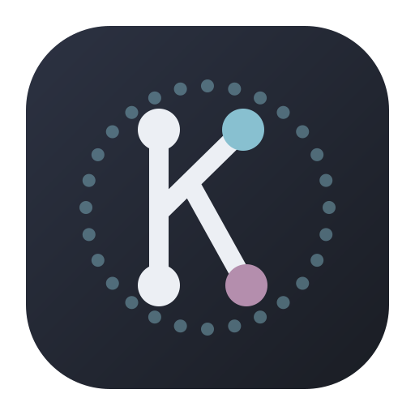

<p align="center">
  
</p>

<h1 align="center">Knowmon</h1>

<p align="center">
  <em>A privacy-first note-taking app with a built-in local AI agent —<br>
  like a gnomon, always pointing toward the light of knowledge.</em>
</p>

<p align="center">
  Local-first Markdown notes that are linked not only by what they reference, but also by when they were written.<br>
  <a href="docs/user-guide/en/README.md">User guide</a> ·
  <a href="#quick-start">Quick start</a>
</p>

An Obsidian-style local Markdown note-taking app with two extra features:

- **Time-context links**: besides `[[wikilink]]`s, notes are linked automatically when they were written in the same session, are about the same day, or are consecutive notes in the same folder.
- **Local AI**: use [Ollama](https://ollama.com) to summarize notes, ask questions about them, or hand tasks to the Agent. By default your notes never leave your computer, and everything else works without Ollama.

<picture>
  <source media="(prefers-color-scheme: dark)" srcset="docs/images/screenshot-dark.png">
  
</picture>

## Quick start

**Users**: download an installer from [Releases](https://github.com/richardlaiis/Knowmon/releases) (Linux: deb, rpm or AppImage; Windows and macOS are experimental). See the [installation guide](docs/user-guide/en/installation.md#download-an-installer) for each platform. The AI features also need [Ollama](https://ollama.com) plus `ollama pull bge-m3` and `ollama pull qwen3:8b`.

**Developers**: run from source. Requires Node.js 22 or later.

```bash
npm install
npm run dev
```

**On Linux, before the first run**, set up the Electron sandbox or the app will crash on startup (repeat this after reinstalling `node_modules`):

```bash
sudo chown root:root node_modules/electron/dist/chrome-sandbox
sudo chmod 4755 node_modules/electron/dist/chrome-sandbox
```

Once it starts, click "Open folder" and choose a folder to use as the vault. To try it out, use `cp -r test-vault ~/knowmon-test-vault`. For other installation problems (`Electron failed to install correctly`, warnings in the terminal, and so on), see the [installation guide](docs/user-guide/en/installation.md#installation-troubleshooting).

## Common commands

| Command                      | Purpose                                                                                   |
| ---------------------------- | ----------------------------------------------------------------------------------------- |
| `npm run dev`                | Development mode (hot reload for the renderer)                                            |
| `npm start`                  | Build and run the production version (add `-- --skipBuild` to run the last build in out/) |
| `npx vitest run`             | Unit and integration tests                                                                |
| `npm run typecheck`          | Type check (don't use `npx tsc --noEmit`: it checks no files)                             |
| `npm run lint`               | ESLint + Prettier                                                                         |
| `npm run build:linux`        | Build the AppImage, deb and rpm in `dist/` (Windows and macOS must build on their own OS) |
| `node scripts/gen-icons.mjs` | Regenerate the platform icons after changing `build/icon.svg` (needs ImageMagick)         |

## Documentation

| To learn about…                                    | See                                             |
| -------------------------------------------------- | ----------------------------------------------- |
| Using Knowmon (features, shortcuts, where data is) | [`docs/user-guide/`](docs/user-guide/README.md) |
| Testing (automated tests, manual checklist)        | [`docs/testing.md`](docs/testing.md)            |
| Goals, technology choices, progress and next steps | [`docs/roadmap.md`](docs/roadmap.md)            |
| Design decisions and implementation details        | [`docs/architecture.md`](docs/architecture.md)  |
| Concepts and rules of the time layer               | [`docs/time-layer.md`](docs/time-layer.md)      |
| Implementation plans and test notes for each phase | [`docs/plans/`](docs/plans/)                    |
| Releasing a new version (CI, packaging, Release)   | [`docs/releasing.md`](docs/releasing.md)        |

## License

[MIT](LICENSE)
