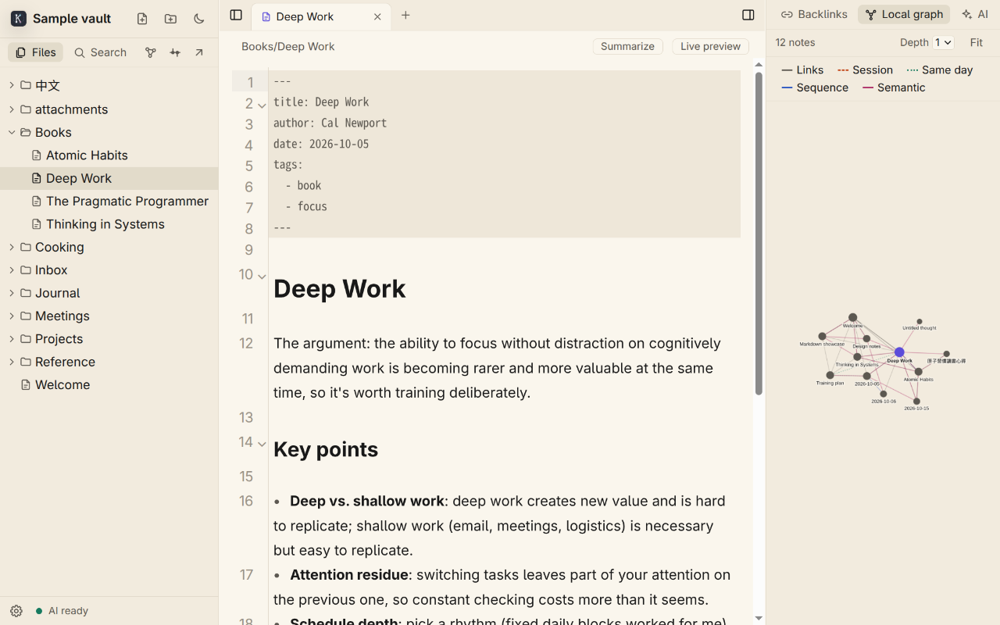

<p align="center">
  
</p>

<h1 align="center">Knowmon</h1>

<p align="center">
  <em>A privacy-first Markdown note-taking app with a built-in local AI agent,<br>
  where notes are linked not only by what they reference but also by when they were written —<br>
  like a gnomon, always pointing toward the light of knowledge.</em>
</p>

<p align="center">
  <a href="docs/user-guide/README.md">User guide</a> ·
  <a href="#quick-start">Quick start</a>
</p>

Knowmon keeps your notes as plain Markdown files in a local folder and adds two features:

- **Time-context links**: besides `[[wikilink]]`s, notes are linked automatically when they were written in the same session, are about the same day, or are consecutive notes in the same folder.
- **Local AI**: use [Ollama](https://ollama.com) to summarize notes, ask questions about them, or hand tasks to the Agent. By default your notes never leave your computer, and everything else works without Ollama.

<picture>
  <source media="(prefers-color-scheme: dark)" srcset="docs/images/screenshot-dark.png">
  
</picture>

## Quick start

**Users**: download an installer from [Releases](https://github.com/richardlaiis/Knowmon/releases) (Linux: deb, rpm or AppImage; Windows and macOS are experimental). See the [installation guide](docs/user-guide/installation.md#download-an-installer) for each platform.

**Developers**: run from source. Requires Node.js 22 or later.

```bash
npm install
npm run dev
```

**On Linux, before the first run**, set up the Electron sandbox or the app will crash on startup (repeat this after reinstalling `node_modules`):

```bash
sudo chown root:root node_modules/electron/dist/chrome-sandbox
sudo chmod 4755 node_modules/electron/dist/chrome-sandbox
```

Once it starts, click "Open folder" and choose a folder to use as the vault. To try it out, use `cp -r test-vault ~/knowmon-test-vault`. For other installation problems (`Electron failed to install correctly`, warnings in the terminal, and so on), see the [installation guide](docs/user-guide/installation.md#installation-troubleshooting).

### Set up local AI (optional)

Knowmon works without AI. Hybrid search, semantic links, summaries, Chat and the Agent need [Ollama](https://ollama.com):

1. Install Ollama from [ollama.com](https://ollama.com). On Linux you can also run:

   ```bash
   curl -fsSL https://ollama.com/install.sh | sh
   ```

   Ollama usually starts in the background after installing. If it doesn't, run `ollama serve`.

2. Download the two default models (about 6 GB in total):

   ```bash
   ollama pull bge-m3      # embedding model: finds notes by meaning
   ollama pull qwen3:8b    # chat model: summaries, answers and Agent tasks
   ```

3. Open a vault in Knowmon. The bottom of the left sidebar shows "Indexing …" while it builds the semantic index, then **AI ready**.

To try other models, browse [ollama.com/search](https://ollama.com/search) (the **Tools** filter shows chat models the Agent can use, **Embedding** shows embedding models), `ollama pull` the one you want, and pick it in Knowmon's AI settings. Avoid tags ending in `-cloud`: they run on Ollama's servers, not your computer. See [Finding other models](docs/user-guide/ai-setup.md#finding-other-models).

AI settings also have **Context length** (default 8192 tokens) and **Max output** (default: the model decides). Context length is how much the model can read at once; raising it lets Knowmon send more note text to summaries, Chat and the Agent, but uses more memory and runs slower on a CPU. Max output caps how long a reply can be, which mainly helps keep cloud costs down. See [Context length and max output](docs/user-guide/ai-setup.md#context-length-and-max-output).

Ollama listens on `http://127.0.0.1:11434` by default, which is what Knowmon expects. To use other models, Ollama on another machine, or a cloud chat provider, click **Settings** in the **AI** tab of the right panel; see [Setting up local AI](docs/user-guide/ai-setup.md) and [Using Ollama on a remote machine](docs/user-guide/remote-ollama.md).

## Using AI

Once the sidebar says **AI ready**, these features are available. Shortcuts use `Ctrl`; on macOS use `Cmd`.

| Feature            | How to start                                        | Good for                                                         |
| ------------------ | --------------------------------------------------- | ---------------------------------------------------------------- |
| **Hybrid search**  | `Ctrl+Shift+F`, switch to **Hybrid**, press `Enter` | Finding a note when you remember the idea but not the words      |
| **Semantic links** | Toggle **Semantic** lines in the graph (`Ctrl+G`)   | Spotting related notes that aren't linked yet                    |
| **Summary**        | `Ctrl+Shift+S` on a note (or on selected text)      | Getting the gist of one long note                                |
| **Chat**           | `Ctrl+Shift+A`, type a question, press `Enter`      | Answers drawn from many notes, with citations                    |
| **Agent**          | `Ctrl+Shift+G`, describe a task, press `Enter`      | Multi-step work: reviewing a period, writing a new note, tagging |

### Hybrid search

Describe what you're looking for in your own words, such as `that note about staying focused`. Knowmon combines word matches, meaning (from the embedding model) and graph neighbors, and labels each result with why it was found. Two date fields narrow results to a period. If AI is offline, it falls back to keyword results.

### Semantic links

The graph can draw lines between notes with similar meaning, even if neither links to the other. Each note links to at most its 5 most similar notes above a 0.65 similarity threshold; both can be changed in the graph's **Settings**. Show only Semantic lines to find connections worth turning into a `[[link]]`.

### Summary

Open a note and press `Ctrl+Shift+S` (or click **Summarize**). Select text first to summarize just that part. The summary is a bullet list that keeps the note's `[[links]]`. Use **中文 / EN** to pick the language (Knowmon remembers it), and **Copy** to paste the summary into a note as Markdown.

### Chat

Ask a question about your notes:

```
What are the main ideas in Deep Work?
Which books did I read last month, and what did I think of them?
```

The AI searches your notes, answers only from what it finds, and marks each statement with a citation like **[1]**. Click a citation to jump to the passage. If your notes don't cover the question, it says so instead of guessing.

- **Mention a time** ("last week", "September", `2026-10-04 to 2026-10-06`, 上週 …) to answer only from notes in that period. The detected range shows above the input; click **×** to drop it or **Date range…** to set your own.
- **Follow up** in the same conversation; click **New chat** to change topics.
- **Copy** an answer and its citations become `[[Source title]]` links, so a note you paste it into links back to its sources.

### Agent

The Agent works through bigger tasks step by step. It searches, reads notes, follows links and time connections, and lists notes from a period. When needed, it can also **create a note** or **add tags**. Every step is shown as it runs.

```
What notes did I write last week, and what does each one link to?
Compare "Atomic Habits" and "Deep Work" in a new note in the "Summaries" folder
Tag last week's journal entries with "review"
```

- **Nothing changes without your approval.** Each new note or tag change appears as a card you can edit, then **Apply** or **Reject**. The Agent never edits or deletes the body of an existing note, and never renames, moves or overwrites files.
- **Write clear tasks:** say the time span ("last week" rather than "recently"), name notes directly, and say what you want back (an answer, a new note in a given folder, or tags).
- **Keep tasks small.** Each task can use tools at most 5 times, so split large jobs or follow up with "now also…".
- It needs a chat model that supports tool calling (the default `qwen3:8b` does). On a CPU only, a task takes about 1–4 minutes.

AI answers in the language you write in. Chat and Agent history live only in memory and are cleared when you quit or switch vaults. For details, see [Search](docs/user-guide/search.md#hybrid-search-by-meaning), [Graph](docs/user-guide/graph.md#semantic-links), [Summary and Chat](docs/user-guide/summary-and-chat.md) and [Agent](docs/user-guide/agent.md).

## Common commands

| Command                      | Purpose                                                                                   |
| ---------------------------- | ----------------------------------------------------------------------------------------- |
| `npm run dev`                | Development mode (hot reload for the renderer)                                            |
| `npm start`                  | Build and run the production version (add `-- --skipBuild` to run the last build in out/) |
| `npx vitest run`             | Unit and integration tests                                                                |
| `npm run typecheck`          | Type check (don't use `npx tsc --noEmit`: it checks no files)                             |
| `npm run lint`               | ESLint + Prettier                                                                         |
| `npm run build:linux`        | Build the AppImage, deb and rpm in `dist/` (Windows and macOS must build on their own OS) |
| `node scripts/gen-icons.mjs` | Regenerate the platform icons after changing `build/icon.svg` (needs ImageMagick)         |

## Documentation

| To learn about…                                    | See                                             |
| -------------------------------------------------- | ----------------------------------------------- |
| Using Knowmon (features, shortcuts, where data is) | [`docs/user-guide/`](docs/user-guide/README.md) |
| Testing (automated tests, manual checklist)        | [`docs/testing.md`](docs/testing.md)            |
| Goals, technology choices, progress and next steps | [`docs/roadmap.md`](docs/roadmap.md)            |
| Design decisions and implementation details        | [`docs/architecture.md`](docs/architecture.md)  |
| Concepts and rules of the time layer               | [`docs/time-layer.md`](docs/time-layer.md)      |
| Implementation plans and test notes for each phase | [`docs/plans/`](docs/plans/)                    |
| Releasing a new version (CI, packaging, Release)   | [`docs/releasing.md`](docs/releasing.md)        |

## License

[MIT](LICENSE)
